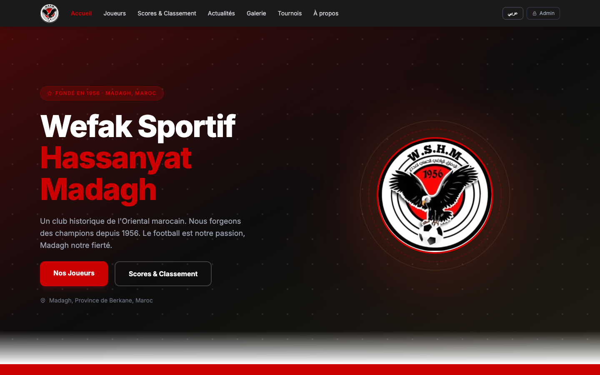
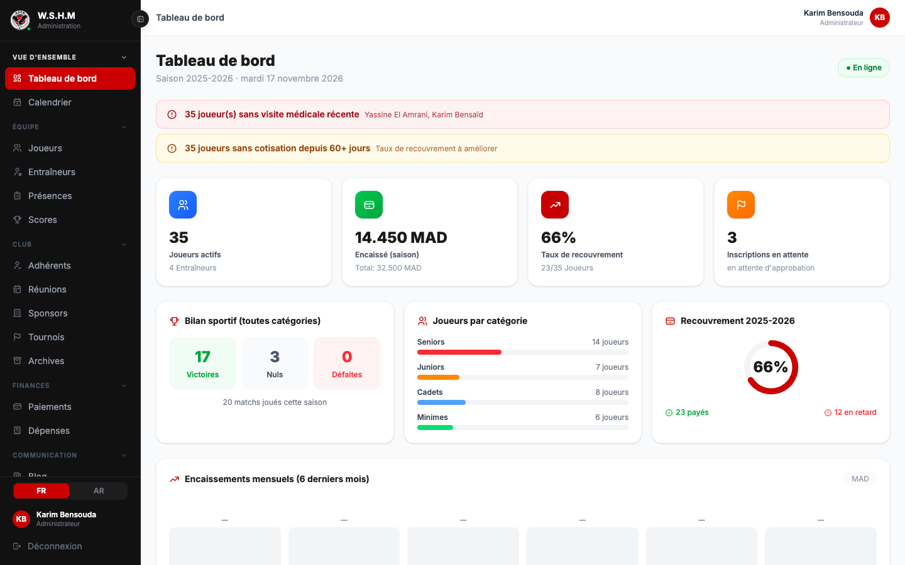
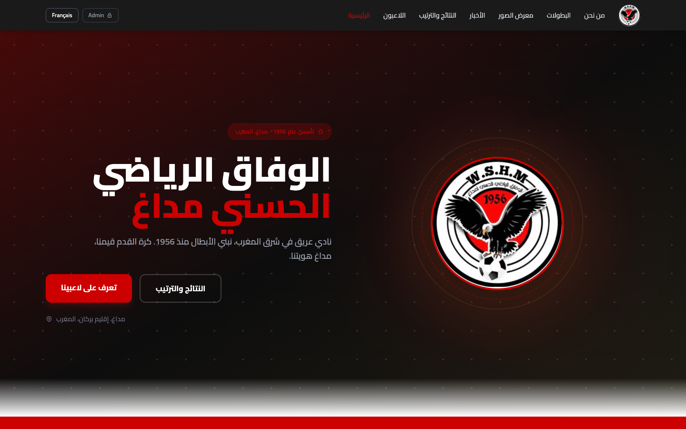
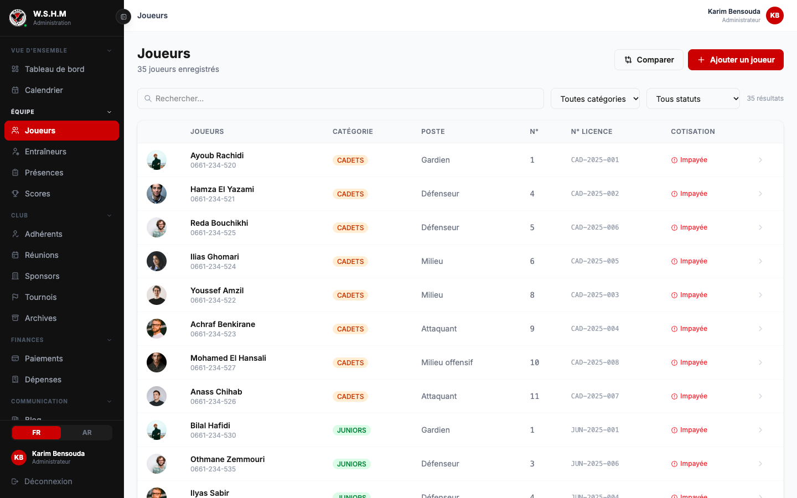
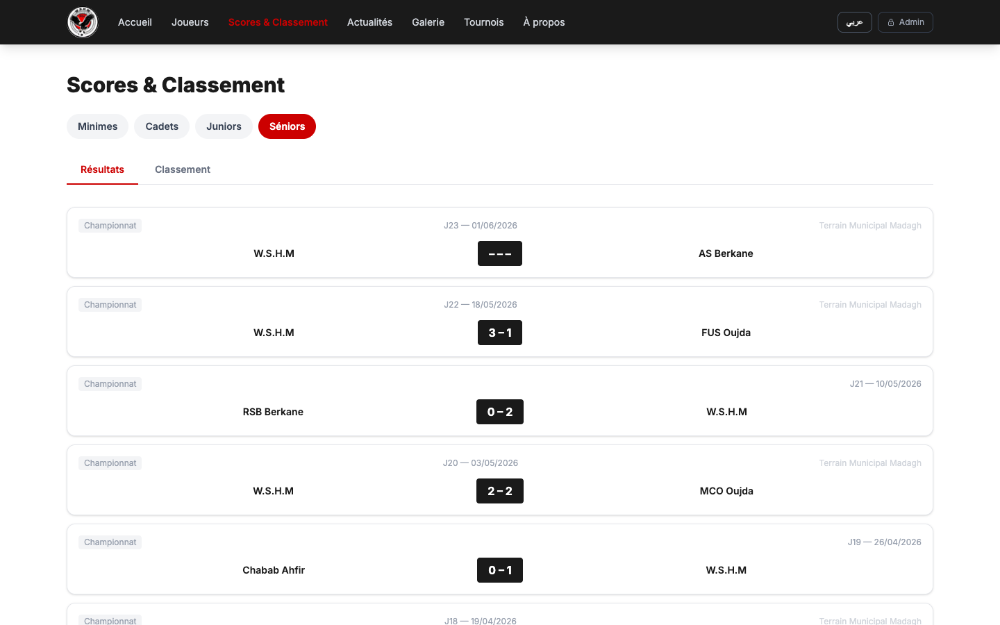
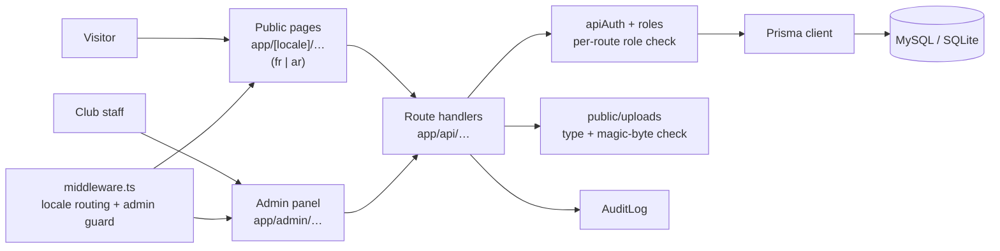

# W.S.H.M club platform

The website and back office of Wefak Sportif Hassanyat Madagh, a football club founded in 1956 in Madagh,
in the province of Berkane, Morocco.

There are two parts. The public site, in French and Arabic (right-to-left), has players, results and league
tables, news, a photo gallery and tournament registration. The admin panel is for the people who run the club:
the president and administrators, the secretary, the coaches and whoever writes the news. Each role
sees only its own part of the panel.



| Admin dashboard | Arabic home page |
|---|---|
|  |  |
| **Player management** | **Results and standings** |
|  |  |

*Screenshots use the demo seed. Names, numbers and photos (Unsplash) are placeholders, not club members.*

## What it does

- **Team:** players by category (U13 to seniors), coaches, training attendance, match results, league table and player stats.
- **Club:** members, board meetings with minutes, a calendar and a document archive.
- **Money:** membership fees with a collection rate per season, expenses and sponsors.
- **Content:** a blog written in a rich-text editor (TipTap) in French and Arabic, an album-based gallery,
  and tournaments with an online registration form that the secretary approves or rejects.
- **Administration:** users and roles, club settings, and an audit log of changes made in the panel.

## Stack

Next.js 16 (App Router) and React 19, TypeScript, Prisma 5 (SQLite locally, MySQL in production), Auth.js v5
with credentials, next-intl for FR/AR, Tailwind CSS 4. It is hosted on a shared Node.js + MySQL plan.

## How it is put together



- Routes under `app/[locale]` are public pages rendered per language. `middleware.ts` handles the locale prefix
  and keeps anyone without a session out of `/admin`.
- Every API route checks the role it needs on the server (`src/lib/apiAuth.ts`, `src/lib/roles.ts`).
  Hiding a menu item is not enough on its own.
- Uploads are checked by size, MIME type and the file's first bytes (magic numbers), so a renamed executable is
  rejected even if its extension says `.jpg`.
- The public tournament registration form is rate-limited per IP (in memory, which is enough for a single
  process on shared hosting).
- Admin changes are written to an audit log with who did what and when.

## Running it locally

```bash
npm ci
cp .env.example .env            # defaults work for local SQLite
npx prisma migrate deploy       # creates prisma/prisma/dev.db
npm run db:seed                 # demo data, including demo logins (see prisma/seed.ts)
npm run dev
```

- Public site: http://localhost:3000/fr (or `/ar`)
- Admin panel: http://localhost:3000/admin

The demo seed creates users with weak, well-known passwords and is for local use only. For a real
deployment, create the first administrator with:

```bash
ADMIN_EMAIL=you@example.org ADMIN_PASSWORD='a long passphrase' npx tsx scripts/seed-admin.ts
```

Production deployment on a shared host is described in [docs/deploy.md](docs/deploy.md), and the security
checklist I worked through is in [docs/security-checklist.md](docs/security-checklist.md).

## What I learned

- Arabic support is more than translation files. Layout direction, number formatting, fonts and icons that
  point "forward" all change, so I built RTL in from the first page instead of adding it at the end.
- Role checks have to live on the server, per route. The sidebar only reflects them.
- `prisma db push` is convenient until someone runs `migrate deploy` on a fresh database. Several tables existed
  only in the schema and not in any migration, and I only caught it when I rebuilt the project from scratch
  (fixed in the history, commit "add the migration that was missing").
- On shared hosting, simple, in-process solutions (in-memory rate limiting, files on local disk) are a fair
  trade-off, as long as their limits are written down.

## License

[MIT](LICENSE)
